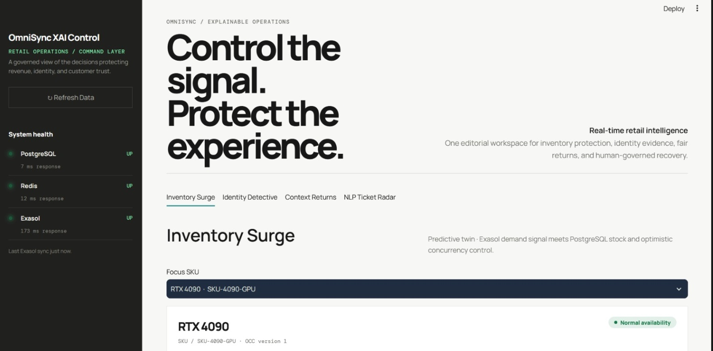
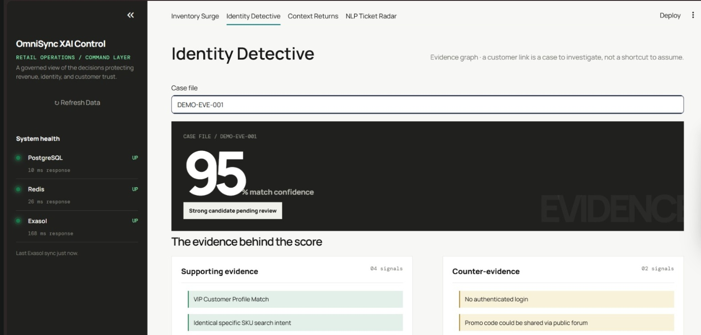
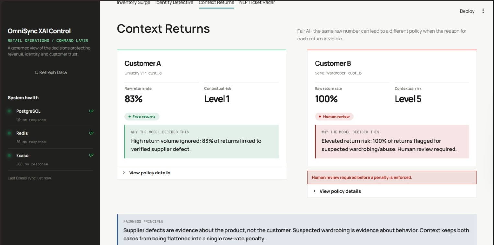
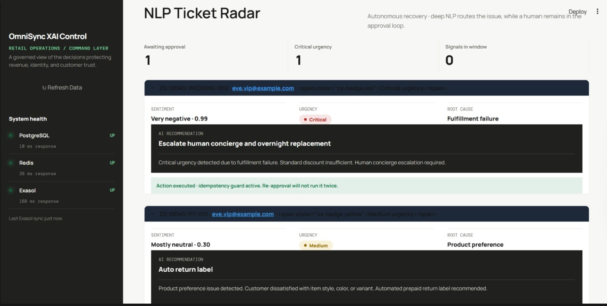

# ⚡ OmniSync: Explainable AI Retail Operations

[](https://opensource.org/licenses/MIT)
[](https://www.python.org/)
[](https://fastapi.tiangolo.com/)
[](https://www.exasol.com/)
[](https://www.postgresql.org/)
[](https://redis.io/)
[](https://docs.celeryq.dev/)
[](https://streamlit.io/)

> **Real-Time Retail Intelligence & Concurrency Defense Engine**  
> OmniSync unifies low-latency transactional execution with in-database machine learning to eradicate overselling, resolve fragmented identities, personalize return friction without checkout latency, and autonomously intercept VIP customer churn. Every decision is mathematically provable, explainable by design (XAI), and governed by human oversight.

---

## 🎯 1. The Problem: 4 Critical Retail Blindspots

Modern omnichannel retail enterprises bleed tens of millions of dollars each year across four disconnected operational silos:

| Operational Challenge | Root Cause & Failure Mode | Enterprise Impact |
| :--- | :--- | :--- |
| **1. Ghost Stockouts & Viral Overselling** | Concurrent checkout spikes (flash sales, viral TikTok surges) cause database race conditions. Inventory counts lag behind live shopping carts, resulting in overselling beyond physical stock. | Forced order cancellations, chargebacks, wasted fulfillment fees, and permanent brand erosion. |
| **2. Fragmented Customer Identity** | Shoppers switch between anonymous mobile cookies, guest checkouts, desktop browsers, and support channels. Naive identity stitching merges disparate users who simply share coupon codes (Honey promo code leakage). | Distorted Lifetime Value (LTV) models, misplaced VIP allocations, and compliance violations. |
| **3. Margin-Eroding Blanket Return Policies** | Retailers enforce rigid blanket return rules. "Free returns" invite serial wardrobing abuse (buying items to wear once and return), while blunt return-rate thresholds unfairly penalize loyal VIPs affected by supplier factory defects. | Surging reverse-logistics freight costs, inventory liquidation loss, and alienated high-value shoppers. |
| **4. Silent VIP Support Churn** | Unhappy high-LTV customers submit frustrated support tickets that linger in standard FIFO queues. Traditional BI pipelines detect churn weeks after the customer has permanently abandoned the platform. | Irreversible VIP attrition, negative public sentiment, and missed retention rescue windows. |

---

## 💡 2. The OmniSync Solution: Detect → Explain → Decide → Act → Verify

OmniSync replaces black-box heuristics with a closed-loop **Explainable AI (XAI)** operational pipeline:

```
    ┌──────────┐      ┌───────────┐      ┌──────────┐      ┌────────┐      ┌──────────┐
    │  DETECT  │ ───► │  EXPLAIN  │ ───► │  DECIDE  │ ───► │  ACT   │ ───► │  VERIFY  │
    └──────────┘      └───────────┘      └──────────┘      └────────┘      └──────────┘
     Live Redis        In-Database        Predictive        Postgres OCC    Streamlit
     Telemetry &       PyTorch & UDF      Safety Buffer     Transaction     Command Center
     Webhooks          Attribution        & Policy Tier     & Eviction      & Human Audit
```

### The 5-Stage XAI Operating Loop:

1. **Detect (Real-Time Ingestion)**
   - Redis sliding-window sorted sets (`cart:{item_id}`) monitor real-time cart velocity over rolling 5-minute intervals.
   - Asynchronous webhook receivers ingest Zendesk support inquiries into Celery with immediate `202 Accepted` acknowledgments, eliminating gateway timeouts.
   - Behavioral web events stream natively into Exasol JSON stores.

2. **Explain (In-Database Machine Learning)**
   - **PyTorch Transformer UDFs** in Exasol score customer support sentiment, classify urgency, and extract root-cause attributions directly within database memory.
   - **Identity Detective**: Exasol’s graph stitching evaluates probabilistic link confidence, presenting operators with clear supporting signals (shared device fingerprint, sequential cart-to-phone handoffs) alongside explicit counter-evidence (differing browser locales).
   - **Context-Aware Return Risk**: Distinguishes customer culpability from product failure by correlating returns against supplier batch defect telemetry (e.g., forgiving returns tied to verified factory defect `BATCH-8992`).

3. **Decide (Predictive Guardrails & Policy Tiers)**
   - **Dynamic Virtual Safety Buffer**: Exasol LightGBM models forecast 15-minute demand velocity to dynamically hold inventory:
     $$\text{Buffer} = \max(0, \text{Predicted\_Demand\_15m} - \text{Physical\_Stock} + \text{Active\_Carts\_5m})$$
   - **Zero-Latency Return Policies**: Pre-calculates 5 friction tiers (Level 1: Free Instant Label $\to$ Level 5: Restocking Fee, COD Disabled, Mandatory Human Review) and syncs them to PostgreSQL for 0ms runtime checkout reads.
   - **VIP Churn Radar**: Cross-references customer sentiment with top 20% LTV metrics to flag accounts with Churn Probability $\ge 0.85$.

4. **Act (Deterministic Execution & OCC Guard)**
   - **Optimistic Concurrency Control (OCC)**: PostgreSQL enforces strict version checking and non-negative constraints (`CHECK (physical_stock >= 0)`):
     ```sql
     UPDATE inventory 
     SET physical_stock = physical_stock - :qty, version = version + 1 
     WHERE item_id = :id AND version = :read_version AND physical_stock >= :qty;
     ```
   - Two-phase inventory reservation lifecycle (`PENDING` $\to$ atomic payment $\to$ `COMPLETED`).
   - Automated retention actions (expedited carrier telemetry, VIP concierge outreach, instant goodwill credits) with idempotency guards to prevent duplicate execution.

5. **Verify (Human-in-the-Loop Governance)**
   - Mission-critical actions surface in the Streamlit Command Center with clear XAI explanations.
   - Human operators have instant authority to approve/reject identity merges or trigger VIP retention playbooks with full immutable audit logging.

---

## 🏛️ 3. Architecture Stack: Hybrid OLTP / OLAP Separation

OmniSync maintains a strict architectural boundary between low-latency transactional execution and heavy analytical intelligence:

```
               +-------------------------------------------------------+
               |                  FastAPI Gateway                      |
               |     (0ms added checkout latency, Webhook Ingest)      |
               +-------------------+--------------------+--------------+
                                   |                    |
                                   v                    v
     +-------------------------------+   +-----------------------------+
     |     PostgreSQL 15 (OLTP)      |   |        Redis Alpine         |
     |  * Product Catalog            |   |  * 5-min Cart Velocity      |
     |  * Strict OCC Ledgers         |   |  * Celery Task Broker       |
     |  * CHECK(physical_stock >= 0) |   +--------------+--------------+
     |  * Pre-computed Risk Cache    |                  |
     +---------------+---------------+                  v
                     ^                   +-----------------------------+
                     |                   |    Celery Worker & Beat     |
                     | EXPORT INTO JDBC  |  * Asynchronous Ingestion   |
                     | (Triggered by     |  * Periodic Sync Orchestrator
                     |  Celery Beat)     +--------------+--------------+
                     |                                  |
     +---------------+----------------------------------v--------------+
     |                 Exasol Personal Edition (OLAP)                  |
     |                   *The Central Brain (In-Memory)*               |
     |  * Python UDFs: LightGBM (Surge) & PyTorch (NLP / Return Risk)  |
     |  * BucketFS: In-Database Model Weight Repository                |
     |  * Native JSON Store: Unstructured Behavioral Web Analytics     |
     |  * Probabilistic Identity Stitching (Golden Record)             |
     +-----------------------------------------------------------------+
```

### Component Breakdown:

- **PostgreSQL 15 (Transactional OLTP)**:
  - Serves as the system of record for inventory, reservations, and sales transactions.
  - Enforces atomic inventory decrements, optimistic version increments, and mathematical non-negative constraints.
  - Houses the indexed `user_risk_cache` for sub-millisecond return friction lookups during customer checkout.
- **Exasol In-Memory OLAP (The Analytical Brain)**:
  - Executes massively parallel processing (MPP) analytical queries on behavioral and transaction data.
  - Runs in-database Python UDFs for LightGBM surge forecasting and PyTorch Transformer ticket classification.
  - **BucketFS Integration**: Model weights remain stored natively inside Exasol's secure BucketFS, guaranteeing that sensitive customer data never leaves database boundaries for external inference.
  - Executes scheduled reverse ETL (`EXPORT INTO JDBC`) to keep PostgreSQL caches synchronized.
- **Redis 7 (Alpine)**:
  - Tracks live shopper cart additions via sorted sets (`ZSET`) expiring outside a rolling 5-minute sliding window.
  - Powers low-latency message queuing for Celery task workers.
- **Celery Worker & Celery Beat**:
  - Asynchronously consumes high-frequency webhook streams from customer support and checkout ingress.
  - Coordinates periodic synchronization between Exasol analytical models and PostgreSQL operational tables.
  - Runs automated cleanup reapers to release expired pending reservations (`expires_at < NOW()`).
- **FastAPI Gateway**:
  - Exposes clean, OpenAPI-compliant endpoints with strict Pydantic v2 data validation.
  - Guarantees 0ms added checkout latency by decoupling complex analytics from the live order path.
- **Streamlit Command Center**:
  - Premium editorial monochrome interface (`#F7F7F5` canvas, `#20201E` dark surfaces, soft semantic badges).
  - Provides interactive simulators for inventory checkout locks, identity governance, return risk recalculation, and live support ticket NLP interception.

---

## 🖥️ 4. UI Showcase: The OmniSync Command Center

The OmniSync Streamlit frontend is a high-performance operator console designed for clarity, explainability, and immediate human governance:

### Tab 1: Inventory Surge & OCC Defense
Real-time inventory twin correlating Exasol demand predictions with PostgreSQL physical stock. Operators can trigger viral shopper surges and verify that concurrent checkouts are mathematically blocked via Optimistic Concurrency Control (OCC) version stamps.


---

### Tab 2: Identity Detective & Evidence Graph
Investigate multi-channel customer identity links. The interface displays probabilistic match confidence scores alongside transparent supporting signals and counter-evidence, backed by a human governance layer to approve or reject merges.


---

### Tab 3: Context-Aware Returns & Risk Sandbox
Fair AI policy engine distinguishing between genuine supplier defects and deliberate serial wardrobing. Includes an interactive Risk Sandbox slider and selector to demonstrate real-time policy adjustments based on causal context.


---

### Tab 4: NLP Ticket Radar & Live Interception
Autonomous VIP retention radar powered by in-database PyTorch NLP UDFs. Operators can intercept critical churn risks, review model sentiment and root-cause explanations, and type custom tickets into the Live Interception console for immediate real-time classification.


---

## 🚀 5. Local Setup & Quickstart

OmniSync is containerized with Docker Compose for single-command orchestration across all 7 services.

### Prerequisites:
- **Docker & Docker Compose** (Compose v2+ recommended)
- **Host Memory**: Minimum **8GB RAM** allocated to the Docker engine (Exasol Personal Edition requires at least 4GB dedicated memory)
- **Privileged Mode**: Docker daemon must permit `--privileged` execution for Exasol (pre-configured in `docker-compose.yml`)

### Step-by-Step Instructions:

```bash
# 1. Clone the repository
git clone https://github.com/poojareddy240208-cyber/ExasolHack.git
cd ExasolHack

# 2. Configure environment variables
cp .env.example .env

# 3. Build and launch the unified platform
docker-compose up -d --build

# 4. View container logs to verify boot sequence
docker-compose logs -f
```

### Service Endpoints:

| Service | Access URL | Credentials / Notes |
| :--- | :--- | :--- |
| **Streamlit Command Center** | [http://localhost:8501](http://localhost:8501) | Live Operator Workspace |
| **FastAPI Interactive Docs** | [http://localhost:8000/docs](http://localhost:8000/docs) | Swagger UI for API Exploration |
| **API Health & Infra Probe** | [http://localhost:8000/health](http://localhost:8000/health) | System Liveness Diagnostic |
| **Exasol SQL Interface** | `localhost:8563` | User: `sys` / Password: in `.env` |
| **Exasol BucketFS Storage** | `http://localhost:2580` | Native Model Weight Repository |

---

## 🧪 6. Testing & Concurrency Verification

To verify race condition protection, Optimistic Concurrency Control (OCC), and the live API bridge:

```bash
# Run the complete automated test suite
pytest -v

# Run OCC high-concurrency race condition simulations (50 competing threads)
pytest tests/test_occ_concurrency.py -v

# Run the live dashboard API bridge test suite
pytest tests/test_live_bridge.py -v
```

---

## 🛡️ Hackathon Constraints & Architecture Compliance

1. **Zero External Data Exfiltration**: PyTorch and LightGBM models execute directly inside Exasol Python UDFs. Model weights are stored securely in Exasol BucketFS.
2. **0ms Added Checkout Latency**: Return risk levels and safety buffers are pre-computed in analytical batches and synced to PostgreSQL. Live checkout operations execute simple O(1) primary key reads.
3. **Probabilistic Coupon Attribution**: Shared promo codes are treated strictly as probabilistic graph weights and never as deterministic identity merge keys, preventing coupon aggregator cross-contamination.
4. **Governed Automation**: High-impact actions (identity merges, retention incentives, high-risk return penalties) require human operator sign-off before downstream execution.

---

## 📄 License
This project is open-source and licensed under the [MIT License](LICENSE).
